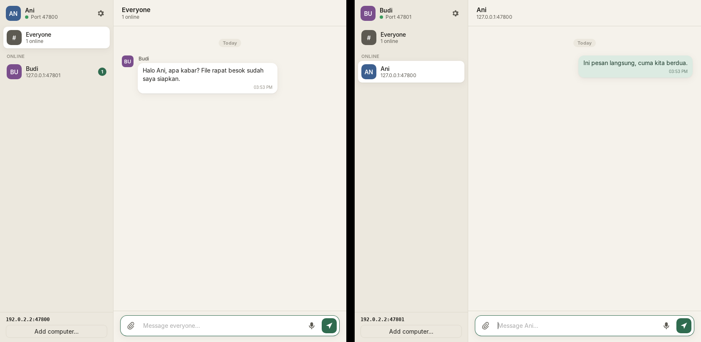

# ChatLocal

[](https://github.com/iniadil/chat-local/actions/workflows/build.yml)
[](https://github.com/iniadil/chat-local/releases/latest)
[](LICENSE)

Chat between computers on the same local network. Text, voice notes, images and
documents. No internet connection, no account, no cloud. Works between Windows
and macOS machines in any combination.



## What it does

- **Finds other computers by itself.** Open the app on two machines connected to
  the same Wi‑Fi or wired network and they show up in each other's sidebar
  (mDNS/Bonjour).
- **Room and direct messages.** "Everyone" is a shared room. Click a person for a
  private conversation only the two of you receive.
- **Voice notes.** Press the microphone, speak, press Send. Recorded as plain WAV
  so every platform can play it.
- **Images and documents.** Attach with the paperclip, drag files onto the window,
  or paste an image from the clipboard. Images show inline; other files appear as
  a card you can open or reveal in the file manager. Every transfer is checked
  with a SHA‑256 hash.
- **History stays on your machine.** Messages and received files are saved
  locally and are still there after a restart.
- **Optional server mode.** If computers cannot see each other directly (several
  subnets, mDNS blocked by the router), make one machine the server and point
  the others at its address. See [Server mode](#server-mode-optional).
- Indonesian and English interface, light and dark themes.

## System requirements

| | Minimum |
|---|---|
| **Windows** | Windows 10 version 1803 or newer, or Windows 11, 64‑bit. Needs the [WebView2 runtime](https://developer.microsoft.com/microsoft-edge/webview2/) (preinstalled on Windows 11 and current Windows 10; the installer downloads it if missing). |
| **macOS** | macOS 11 Big Sur or newer. Separate builds for Apple Silicon (M1 and later) and Intel. |
| **Memory** | 4 GB RAM. The app itself uses about 100–150 MB; a file being sent or received is held in memory during transfer, so sending a 500 MB file briefly needs that much free RAM. |
| **Disk** | About 30 MB for the app, plus space for received files (`files/` in the data folder). |
| **Network** | Wi‑Fi or Ethernet on the same local network, TCP port 47800 (configurable) reachable between machines, and UDP port 5353 (mDNS) for automatic discovery. Internet is not needed. |
| **Microphone** | Any built‑in or USB microphone, only for voice notes. |

Linux is not shipped as an installer but builds from source on any distribution with WebKitGTK 4.1.

## Install

Download the latest installer from the
[Releases](https://github.com/iniadil/chat-local/releases) page. Each release
contains:

| File | For |
|------|-----|
| `ChatLocal_x.y.z_x64-setup.exe` | Windows 10/11, installer (recommended) |
| `ChatLocal_x.y.z_x64_en-US.msi` | Windows 10/11, MSI package |
| `ChatLocal_x.y.z_aarch64.dmg` | macOS 11+, Apple Silicon (M1 and later) |
| `ChatLocal_x.y.z_x64.dmg` | macOS 11+, Intel |

The builds are not code‑signed (signing certificates cost money), so both
operating systems warn you the first time:

- **Windows** shows a SmartScreen dialog. Click *More info* → *Run anyway*.
  On first launch Windows Firewall asks to allow ChatLocal: tick **Private
  networks** and allow it, otherwise other computers cannot reach you.
- **macOS** says the app "cannot be opened because the developer cannot be
  verified". Right‑click the app → *Open* → *Open*, or run
  `xattr -dr com.apple.quarantine /Applications/ChatLocal.app` once in Terminal.
  macOS also asks for microphone access the first time you record a voice note
  and for local‑network access the first time the app searches for peers.

Windows needs the WebView2 runtime; it is preinstalled on Windows 10 (recent
builds) and 11, and the installer fetches it if missing.

## Using it

1. Open ChatLocal on two or more computers on the same network.
2. Within a few seconds the other computers appear under **Online**.
3. Click **Everyone** to write to the room, or click a name for a direct message.
4. Use the paperclip for files, the microphone for a voice note, or drag a file
   onto the window.

If a computer does not appear automatically, click **Add computer…** at the
bottom of the sidebar and type the address shown at the bottom of *its*
sidebar (for example `192.168.1.23:47800`). Tick *Remember* to reconnect
automatically next time.

### Server mode (optional)

No server is needed on a normal home or office network. Use server mode when:

- the computers are on different subnets or VLANs,
- the router blocks mDNS/Bonjour, or
- you simply want one well‑known address everyone connects to.

Setup:

1. On the machine that will act as the server, open **Settings** and turn on
   **Make this computer a server (relay)**. Note its address at the bottom of
   the sidebar.
2. On every other machine, open **Settings** and add that address under
   **Manual addresses**, then Save.

The server forwards room messages and direct messages between the computers
connected to it and shares the list of who is online. A direct message passing
through the server is not stored on it; only the recipient keeps it. Any
ChatLocal installation can be the server, it is just a checkbox.

### Settings

| Setting | Meaning |
|---------|---------|
| Display name | The name others see. Defaults to the computer name. |
| Language | Bahasa Indonesia or English. |
| Find other computers automatically | mDNS discovery on/off. |
| Port | TCP port this machine listens on (default `47800`). Change it if another program uses it. |
| Manual addresses | Other computers or a server, one per line, as `IP` or `IP:port`. |
| Make this computer a server | Relay mode as described above. |
| Clear history | Deletes the message log on this machine. Received files are kept. |

### Where data lives

| OS | Folder |
|----|--------|
| Windows | `%APPDATA%\app.chatlocal.desktop\` |
| macOS | `~/Library/Application Support/app.chatlocal.desktop/` |

Inside: `messages.jsonl` (history), `files/` (sent and received attachments),
`settings.json`, and `identity.json` (a random ID that identifies this
installation to others; delete it to get a new identity).

## How it works

Each running copy of ChatLocal is a peer. It listens on a TCP port, announces
itself with mDNS (`_chatlocal._tcp`), and opens a connection to every peer it
learns about. Messages are JSON frames with a length prefix; attachments ride
along as a binary payload after the JSON header. Two peers that dial each
other at the same moment keep exactly one connection (the one started by the
lower ID). A peer in server mode forwards frames between its connections and
publishes a roster so clients can see each other through it; every peer
de‑duplicates by message ID, so loops are harmless.

Traffic is **not encrypted**. ChatLocal is meant for a network you trust (your
home, office or classroom LAN). Anyone on that network could read the traffic
or connect with a made‑up name, exactly as with a shared printer or file share.

## Build from source

Prerequisites:

- [Rust](https://www.rust-lang.org/tools/install) (stable, 1.80 or newer)
- [Node.js](https://nodejs.org/) 20 or newer
- Platform build tools listed in the
  [Tauri prerequisites](https://tauri.app/start/prerequisites/)
  (Visual Studio Build Tools + WebView2 on Windows; Xcode Command Line Tools on
  macOS; `libwebkit2gtk-4.1-dev` and friends on Linux).

```sh
git clone https://github.com/iniadil/chat-local.git
cd chat-local
npm install          # frontend and Tauri CLI
npm run tauri dev    # run with hot reload
npm run tauri build  # produce installers in target/release/bundle/
```

Useful checks:

```sh
cargo test -p lanchat-net   # networking core: framing, storage, two- and three-node tests over loopback
cargo clippy --workspace    # lints
npm run typecheck           # TypeScript
```

### Building installers with GitHub Actions

[`.github/workflows/build.yml`](.github/workflows/build.yml) builds the Windows
and macOS installers on GitHub's runners. Push a tag such as `v0.1.0` and the
workflow creates a draft release with all installers attached; every push to
`main` uploads them as workflow artifacts instead. No secrets are required.

## Project layout

```
crates/lanchat-net/   Rust library: protocol, discovery, relay, history (no UI, fully testable)
src-tauri/            Tauri app: window, commands, settings, event bridge
src/                  Frontend: TypeScript, no framework
.github/workflows/    CI and installer builds
```

## Dependencies

Everything below is open source. Versions are pinned in `Cargo.lock` and
`package-lock.json`.

| Dependency | Used for | Source |
|------------|----------|--------|
| Tauri 2 | Desktop shell (window, bundling, IPC) | https://github.com/tauri-apps/tauri · MIT/Apache‑2.0 |
| tauri-plugin-dialog | Native file picker | https://github.com/tauri-apps/plugins-workspace · MIT/Apache‑2.0 |
| tauri-plugin-opener | Open a file / reveal in folder | https://github.com/tauri-apps/plugins-workspace · MIT/Apache‑2.0 |
| tokio, tokio-util | Async networking | https://github.com/tokio-rs/tokio · MIT |
| mdns-sd | mDNS/DNS‑SD discovery | https://github.com/keepsimple1/mdns-sd · MIT/Apache‑2.0 |
| local-ip-address | Listing this machine's IP addresses | https://github.com/EstebanBorai/local-ip-address · MIT/Apache‑2.0 |
| serde, serde_json | JSON (de)serialization | https://github.com/serde-rs/serde · MIT/Apache‑2.0 |
| sha2, hex | Attachment integrity check | https://github.com/RustCrypto/hashes · MIT/Apache‑2.0 |
| uuid | Message and peer IDs | https://github.com/uuid-rs/uuid · MIT/Apache‑2.0 |
| mime_guess | File type from extension | https://github.com/abonander/mime_guess · MIT |
| hostname | Default display name | https://github.com/svartalf/hostname · MIT |
| base64 | Voice notes/pasted images over IPC | https://github.com/marshallpierce/rust-base64 · MIT/Apache‑2.0 |
| thiserror, tracing, tracing-subscriber | Errors and logging | https://github.com/dtolnay/thiserror · https://github.com/tokio-rs/tracing · MIT |
| Vite, TypeScript | Frontend build | https://vitejs.dev · https://www.typescriptlang.org · MIT/Apache‑2.0 |
| @tauri-apps/api | Frontend ↔ Rust bridge | https://github.com/tauri-apps/tauri · MIT/Apache‑2.0 |

The frontend uses no UI framework and no icon library; the icons are inline
SVG. GitHub Actions uses
[tauri-apps/tauri-action](https://github.com/tauri-apps/tauri-action),
[dtolnay/rust-toolchain](https://github.com/dtolnay/rust-toolchain) and
[Swatinem/rust-cache](https://github.com/Swatinem/rust-cache).

## Status and known limits

This first version was developed and verified on Linux (two instances talking
over loopback, including file transfer, server mode, settings restart and the
automated network tests). It has **not yet been run on real Windows or macOS
hardware**. The code paths that differ per platform and deserve a first check
there:

- mDNS discovery across real Wi‑Fi (some access points isolate clients; use
  *Add computer…* or server mode if so).
- Microphone permission prompts (WebView2 on Windows, WKWebView on macOS).
- Playback of voice notes (WAV is supported natively on both; the Linux test
  container had no audio stack).

Other limits: attachments are held in memory during transfer and capped at
512 MB; there is no encryption; there are no read receipts or typing
indicators; a message to a computer that is offline is rejected rather than
queued.

## Contributing

See [CONTRIBUTING.md](CONTRIBUTING.md). Release history is in
[CHANGELOG.md](CHANGELOG.md), and the security model is described in
[SECURITY.md](SECURITY.md).

## License

[MIT](LICENSE)
